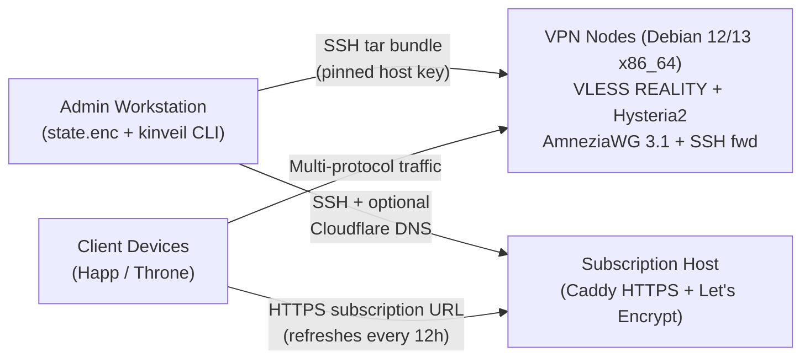

# kinveil

A local encrypted CLI control plane for running an anti-censorship, DPI-resistant VPN for a private group or trusted circle across disposable Debian servers—with no web panels, agent daemons, or databases running on your VPSes.

`kinveil` is built for a Linux or macOS administrator managing access for non-technical users. One encrypted local vault (`~/.local/share/kinveil/state.enc`, **Argon2id + AES-256-GCM**) holds all inventory, credentials, and commented configuration, deployments stream over pinned-host-key SSH, and each user imports a single auto-updating subscription URL or QR code.

## How It Works



| Alternative | How `kinveil` differs |
| --- | --- |
| **3x-ui / Marzban** | Zero server-side control panel, database, or Docker daemon—no panel fingerprinting or remote admin CVEs. |
| **Tailscale / `wg-easy`** | Combines VLESS REALITY XHTTP (`stream-up` & `packet-up`), Hysteria2 + Salamander, AmneziaWG 3.1 obfuscation (`RandomTrailers`, `DisableCookies`, CPS `I1`..`I5`, per-peer PSK), and optional SSH forwarding behind one subscription link. |
| **Disposable VPS fleet** | Servers hold no authoritative state: replace a throttled VPS, run `kinveil deploy`, and client links stay unchanged. |

## Install

Download a release archive from [GitHub Releases](https://github.com/manul17/kinveil/releases) (each archive includes SHA-256 checksums, build provenance attestation, and preverified `xray` and `amneziawg-go` server binaries):

```bash
tar -xzf kinveil-v0.1.0-<target>.tar.gz
./kinveil-v0.1.0-<target>/install.sh
```

Or build from source (Rust >= 1.89):

```bash
cargo build --release --locked
install -m 0755 target/release/kinveil ~/.local/bin/kinveil
```

### Prerequisites

- **Workstation:** Linux or macOS (`x86_64` / `arm64`) with OpenSSH client (`ssh`). **Neither Go nor `git` is required:** release archives bundle preverified `xray` and `amneziawg-go` server binaries in `share/kinveil/artifacts/`, and source builds automatically download SHA-256-verified prebuilt binaries for both (`go >= 1.25` + `git` are only used as a fallback if the prebuilt download is unreachable and AmneziaWG is enabled).
- **Target VPS(es):** Dedicated **Debian 12 or Debian 13** (`x86_64`, KVM / `/dev/net/tun` enabled for AmneziaWG) with **SSH public-key login (`ssh-copy-id`)** as `root` (or passwordless `sudo`).

> [!WARNING]
> **Dedicated VPS policy:** `kinveil deploy` owns `/etc/nftables.conf` (default-`drop` `input` and `forward` policies) and disables `ufw`. Initial deployments abort if Docker, web proxies, active firewalls, or custom nftables tables are detected unless `--takeover` is passed (see [Admin Guide](docs/admin-guide.md#1-prerequisites)).

## Quickstart

1. Initialize your encrypted vault (passphrase >= 12 chars, >= 4 distinct chars):

   ```bash
   kinveil init --domain sub.example.com
   ```

   Avoid repeated passphrase prompts by pulling from your OS keychain or `pass` (more examples in the [Admin Guide](docs/admin-guide.md#8-environment-variables-artifact-overrides--automation)):

   ```bash
   export KINVEIL_PASSPHRASE_COMMAND="pass show kinveil/vault"
   ```

2. Add your first VPS (confirm the SSH host key fingerprint from `ssh-keygen -lf /etc/ssh/ssh_host_ed25519_key.pub`):

   ```bash
   kinveil server add 203.0.113.10 --label "DE Germany" --sni dl.google.com
   ```

   Choose a nearby third-party TLS 1.3 + HTTP/2 (`h2`) domain not blocked for your users and **never** your `subscription` domain (change anytime via `kinveil server update <id> --sni <domain>`; see [Admin Guide §4](docs/admin-guide.md#4-choosing-a-reality---sni-target)). Single-VPS tip: pass `--hysteria2-port 443` so Hysteria2 serves on `443/udp` while Caddy serves HTTPS subscriptions on `443/tcp`.

3. Point DNS (unproxied `A`/`AAAA` record) for `sub.example.com` to that server IP, or enable Cloudflare automation:

   ```bash
   kinveil cloudflare set --zone-id <CLOUDFLARE_ZONE_ID>
   ```

4. Open `22/tcp`, `8443/tcp`, `9443/udp` (or `443/udp`), `7443/udp`, `80,443/tcp` (and `2222/tcp` if `ssh-forwarding` is enabled) in your cloud firewall, then add users, preview with `--dry-run`, deploy, and verify:

   ```bash
   kinveil user add alice bob
   kinveil deploy --dry-run
   kinveil deploy
   kinveil check --ssh
   ```

5. Print Alice's subscription URL, terminal QR code, client setup steps, and usage tips:

   ```bash
   kinveil user share alice
   ```

Check inventory and deploy readiness anytime with `kinveil show`:

```text
Kinveil state: ~/.local/share/kinveil/state.enc
  Revision:            4
  Deploy status:       ready
  Subscription domain: sub.example.com (interval=12h, base_path=<redacted>)
  Settings defaults:   vless=8443/tcp, hysteria2=9443/udp, amneziawg=7443/udp, ssh-forwarding=2222/tcp, subnet=10.8.0.0/16, mtu=1360, protocols=[vless-stream,vless-packet,hysteria2,amneziawg,ssh-forwarding]
  Firewall:            block_private_networks=true, block_bittorrent=true
  Servers (1):
    - de-germany (DE Germany) [enabled] ipv4=203.0.113.10 ipv6=- ssh=root@203.0.113.10:22 roles=[vpn,subscription] ports=[vless=8443/tcp,hysteria2=9443/udp,amneziawg=7443/udp,https=80,443/tcp,ssh-forwarding=2222/tcp] sni=dl.google.com
  Users (2, 2 enabled):
    - uid=1 name=alice [enabled] created=2026-11-15
    - uid=2 name=bob [enabled] created=2026-11-15
```

Global defaults (`[firewall]`, `[subscription]`, `[vless]`, `[hysteria2]`, `[amneziawg]`, `[ssh_forwarding]`, `[sysctl]`, and `[artifacts]`) are seeded from [`config.example.toml`](config.example.toml) inside `state.enc`. Run `kinveil config` to edit those commented TOML presets safely in RAM without exposing private keys to your editor.

Recommended apps: **Happ** (iOS, Android, macOS, Windows) and **Throne** (Windows, macOS, Linux; also imports SSH forwarding). Avoid Karing `1.2.25` (due to an `X25519MLKEM768` handshake bug), and connect at most one device per user simultaneously on AmneziaWG (`vless-*` and `hysteria` allow multiple devices).

## Documentation

| Guide | Topics Covered |
| --- | --- |
| [Admin Guide](docs/admin-guide.md) | Firewalls & `--takeover`, port `443` layout, DNS & Cloudflare, `--sni` selection & updates, `kinveil config` sections & `[artifacts]` overrides, multi-server topologies, key rotation, `KINVEIL_*` automation, troubleshooting |
| [Design & Invariants](docs/design.md) | `KVEL\x01` vault crypto, systemd sandboxing, `table inet kinveil` + unified egress filter, SSRF protections, wire formats |
| [Configuration Reference](config.example.toml) | All commented global defaults (`[firewall]`, `[subscription]`, `[vless]`, `[hysteria2]`, `[amneziawg]`, `[ssh_forwarding]`, `[sysctl]`, `[artifacts]`) |

## Security & License

See [SECURITY.md](SECURITY.md) for security boundaries and vulnerability reporting.

Licensed under the **MIT License** ([LICENSE](LICENSE)).
