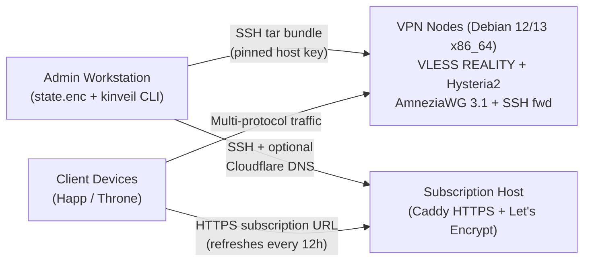

# kinveil

A local encrypted CLI control plane for running an anti-censorship, DPI-resistant VPN for a private group across disposable Debian servers—with no web panels, agent daemons, or databases running on your VPSes.

One encrypted local vault (`~/.local/share/kinveil/state.enc`, **Argon2id + AES-256-GCM**) holds all inventory, credentials, and commented TOML configuration; deployments stream over pinned-host-key SSH, and each user imports a single auto-updating subscription URL or QR code.

## How It Works



| Alternative | How `kinveil` differs |
| --- | --- |
| **3x-ui / Marzban** | Zero server-side control panel, database, or Docker daemon—no panel fingerprinting or remote admin CVEs. |
| **Tailscale / `wg-easy`** | Combines VLESS REALITY XHTTP (`stream-up` & `packet-up`), Hysteria2 + Salamander, AmneziaWG 3.1 obfuscation (`RandomTrailers`, `DisableCookies`, CPS `I1`..`I5`, per-peer PSK), and optional SSH forwarding behind one subscription link. |
| **Disposable VPS fleet** | Servers hold no authoritative state: replace a throttled VPS, run `kinveil deploy`, and client links stay unchanged. |

## Install

Download a Linux release archive (`x86_64-unknown-linux-musl` or `aarch64-unknown-linux-musl`) from [GitHub Releases](https://github.com/manul17/kinveil/releases) (includes SHA-256 checksums, build provenance attestation, and preverified `xray` and `amneziawg-go` server binaries), or build from source on Linux or macOS (`cargo build --release --locked`, Rust >= 1.89):

```bash
tar -xzf kinveil-v0.1.0-<target>.tar.gz
./kinveil-v0.1.0-<target>/install.sh
```

- **Workstation:** Linux (prebuilt `x86_64`/`aarch64` release archives) or macOS (`x86_64`/`arm64`, build from source) with OpenSSH (`ssh`). Neither Go nor `git` is needed in normal use (preverified binaries are bundled or downloaded via SHA-256).
- **Target VPS(es):** Dedicated **Debian 12 or Debian 13** (`x86_64`, `/dev/net/tun` enabled for AmneziaWG) with key-based SSH login as `root` (or passwordless `sudo`).

> [!WARNING]
> **Dedicated VPS policy:** `kinveil deploy` owns `/etc/nftables.conf` (default-`drop` `input` and `forward` policies) and disables `ufw`. Initial deployments abort if Docker, web proxies, or custom firewalls are detected unless `--takeover` is passed (see [Admin Guide §1](docs/admin-guide.md#1-prerequisites)).

## Quickstart

1. Initialize the vault and optionally cache the passphrase via your keychain or `pass`:

   ```bash
   kinveil init --domain sub.example.com
   export KINVEIL_PASSPHRASE_COMMAND="pass show kinveil/vault"
   ```

2. Add a VPS (verify host key fingerprint via `ssh-keygen -lf /etc/ssh/ssh_host_ed25519_key.pub`; choose a nearby TLS 1.3 + `h2` domain for `--vless-sni`, never your `subscription` domain):

   ```bash
   kinveil server add 203.0.113.10 --label "DE Germany" --vless-sni dl.google.com
   ```

   Hysteria2 defaults to `443/udp` alongside Caddy HTTPS on `443/tcp`. On dedicated `vpn` nodes (without `subscription`), pass `--vless-port 443` to serve VLESS on `443/tcp` too.

3. Point unproxied `A`/`AAAA` DNS for `sub.example.com` to the server IP, or enable Cloudflare DNS automation:

   ```bash
   kinveil subscription cloudflare set --zone-id <CLOUDFLARE_ZONE_ID>
   ```

4. Open `22/tcp`, `8443/tcp`, `443/udp`, `7443/udp`, `80,443/tcp` (and `2222/tcp` if `ssh-forwarding` is enabled) in your cloud firewall, then add users, preview, deploy, and verify:

   ```bash
   kinveil user add alice bob
   kinveil deploy --dry-run
   kinveil deploy
   kinveil check --ssh
   kinveil user share alice
   ```

Inspect vault readiness anytime with `kinveil show` (or `kinveil server show <id>` / `kinveil user show <name>`), opt specific capped servers into UID-only byte accounting via `--traffic` (`kinveil traffic --from YYYY-MM-DD --to YYYY-MM-DD`), and edit global defaults or AmneziaWG CPS `I1`..`I5` overrides safely in `/dev/shm` via `kinveil config`.

Recommended clients: **Happ** (iOS, Android, macOS, Windows) and **Throne** (Windows, macOS, Linux; also imports SSH forwarding). Avoid Karing `1.2.25` (`X25519MLKEM768` handshake bug), and connect at most 1 simultaneous device per user on `amneziawg` (`vless-*` and `hysteria2` allow multiple devices).

## Documentation & Security

- [Admin Guide](docs/admin-guide.md) — Port `443` topologies, `kinveil subscription`, REALITY SNI & AmneziaWG `I1`..`I5` tuning, VPS footprint, credential export, key rotation, `KINVEIL_*` env vars, and troubleshooting.
- [Configuration Reference](config.example.toml) — All commented global defaults (`[firewall]`, `[firewall.auto_update]`, `[firewall.xray]`, `[dns]`, `[subscription]`, `[subscription.routing]`, `[vless]`, `[vless.xhttp]`, `[vless.xmux]`, `[hysteria2]`, `[amneziawg]`, `[amneziawg.obfuscation]`, `[ssh_forwarding]`, `[traffic]`, `[sysctl]`, `[artifacts]`).
- [Security Policy](SECURITY.md) — Vault encryption, RAM-backed editing, binary/SSH verification, and SSRF isolation boundaries.

Licensed under the **MIT License** ([LICENSE](LICENSE)).
